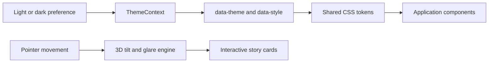
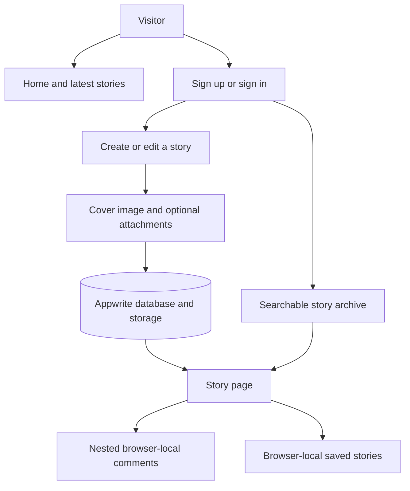

# InkSpace

<p align="center">
  <a href="https://ink-space-aryan.vercel.app/">
    
  </a>
</p>

<p align="center">
  A responsive blogging platform for discovering, writing, and sharing stories.
</p>

<p align="center">
  <a href="https://ink-space-aryan.vercel.app/">Open the live website</a>
</p>

InkSpace is a React single-page application backed by Appwrite. Readers can browse and save stories, while authenticated authors can publish and manage posts. The interface combines a machined-metal visual style with interactive 3D card effects and light/dark themes.

## Features

- **Story discovery:** Browse the home feed and searchable story archive.
- **Accounts and authoring:** Sign up and sign in with Appwrite, then create, edit, or delete stories. Authors can manage their own stories; configured admins can manage stories as well.
- **Rich text publishing:** Write and format posts with a locally hosted TinyMCE editor.
- **Image and document attachments:** Add a required cover image and up to 10 additional images or PDFs. Each selected file can be up to 10 MB.
- **Reading list:** Bookmark stories and search or clear the list. Saved items persist in browser storage and synchronize between open tabs on the same browser.
- **Story discussions:** Add nested comments and replies, and edit or delete comments you own. Comments are stored in the current browser's local storage; they are not shared between readers or persisted to Appwrite.
- **Story sharing:** Use the device's share sheet when available, or copy a story link.
- **Responsive navigation:** Desktop navigation plus a mobile bottom dock and menu.
- **Light and dark themes:** Theme preference is saved in browser storage and follows the system preference until changed.
- **Interactive 3D presentation:** Story cards use pointer-responsive tilt and glare effects.

## Theme and interaction system

The active visual style is a unified **Skeuomorphism Interactive 3D** theme. It uses metallic surfaces, tactile edges, depth, and pointer-responsive card effects. Light and dark are the two supported color modes; the app does not currently offer a switch between multiple aesthetics.

The theme context applies `data-theme` and `data-style` attributes to the root HTML element. CSS tokens define shared colors and surfaces, while the theme styles apply the active look. The tilt engine adds pointer-responsive 3D transforms to story cards.



The repository also contains styles for other aesthetics, but those are not exposed as selectable themes in the current app.

## Application flow



### Routes

| Route              | Purpose                                | Access                           |
| ------------------ | -------------------------------------- | -------------------------------- |
| `/`                | Home page and latest published stories | Public                           |
| `/login`           | Sign in                                | Signed-out visitors              |
| `/signup`          | Create an account                      | Signed-out visitors              |
| `/all-posts`       | Search the story archive               | Signed-in users                  |
| `/add-post`        | Create a story                         | Signed-in users                  |
| `/edit-post/:slug` | Edit a story                           | Signed-in users; author or admin |
| `/post/:slug`      | Read a story and join its discussion   | Public                           |
| `/saved-posts`     | Manage saved stories                   | Available in the current browser |

## Technology

| Technology                    | Purpose                                                       |
| ----------------------------- | ------------------------------------------------------------- |
| React 19 and Vite             | User interface and development/build tooling                  |
| React Router                  | Client-side routes and route guards                           |
| Redux Toolkit and React Redux | Authentication and saved-story state                          |
| Appwrite                      | Account authentication, document database, and file storage   |
| React Hook Form               | Publishing and account forms                                  |
| TinyMCE                       | Rich text story editor, served locally from `public/tinymce/` |
| Tailwind CSS 4 and CSS        | Responsive layout, design tokens, and theme styling           |

## Project structure

```text
public/
├── Ink space.png              # App icon used in this README
└── tinymce/                   # Locally hosted TinyMCE assets
src/
├── appwrite/
│   ├── auth.js                # Appwrite account service
│   └── conf.js                # Database, post, and file services
├── components/                # Shared UI, navigation, editor, and comments
├── conf/config.js             # Appwrite and admin environment configuration
├── context/ThemeContext.jsx   # Theme state and root document attributes
├── hooks/                     # Saved posts and tree-based comment helpers
├── pages/                     # Home, authentication, archive, editor, and story pages
├── store/                     # Redux authentication and saved-post slices
├── styles/                    # Design tokens and aesthetic styles
├── utils/                     # Theme engine and admin helpers
├── App.jsx                    # App shell and session hydration
└── main.jsx                   # Redux, theme, and router setup
```

## Appwrite setup

1. Create an Appwrite project and configure its **Web platform** with your local and deployed origins.
2. Create an authentication setup that supports email/password accounts.
3. Create a database and a posts collection. Set the collection identifier in `VITE_APPWRITE_TABLE_ID`.
4. Create a storage bucket for cover images and attachments. Configure bucket and document permissions to match your publishing and reading access requirements.
5. Add the environment variables below to a local `.env` file. `.env.sample` is provided as a template.

```env
VITE_APPWRITE_URL="https://cloud.appwrite.io/v1"
VITE_APPWRITE_PROJECT_ID="your_project_id"
VITE_APPWRITE_DATABASE_ID="your_database_id"
VITE_APPWRITE_TABLE_ID="your_posts_collection_id"
VITE_APPWRITE_BUCKET_ID="your_storage_bucket_id"
VITE_ADMIN_EMAILS="admin@example.com"
```

`VITE_ADMIN_EMAILS` is optional and accepts a comma-separated list of email addresses. The app uses it to identify admin users in its client-side interface.

### Posts collection attributes

The post service expects these document attributes:

| Attribute       | Type            | Required | Purpose                                      |
| --------------- | --------------- | -------: | -------------------------------------------- |
| `title`         | String (255)    |      Yes | Story title                                  |
| `content`       | String (65,535) |      Yes | Rich text story content                      |
| `featuredimage` | String (255)    |      Yes | Cover image file ID                          |
| `status`        | String (50)     |      Yes | Publication state, such as `active`          |
| `userid`        | String (255)    |      Yes | Appwrite ID of the author                    |
| `authorName`    | String (255)    |       No | Display name for the author                  |
| `media`         | String (65,535) |       No | JSON metadata for additional image/PDF files |

The story slug is used as the Appwrite document ID, so it does not need a separate `slug` attribute. The service can embed attachment metadata in the content when optional `media` or `authorName` attributes are absent.

## Run locally

### Requirements

- Node.js `^20.19.0` or `>=22.12.0` (required by the Vite version in this project)
- npm
- An Appwrite project configured as described above

### Install and start

```bash
git clone https://github.com/Aryan-Patel-CSE/Blogging-Website-.git
cd Blogging-Website-
npm install
```

Create `.env` with your Appwrite settings, then start the development server:

```bash
npm run dev
```

Vite prints the local URL when the server starts (usually `http://localhost:5173`).

### Checks and production preview

```bash
npm run lint
npm run build
npm run preview
```

## License

This repository does not currently include a license file.
